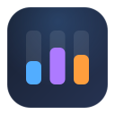
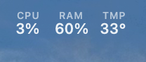
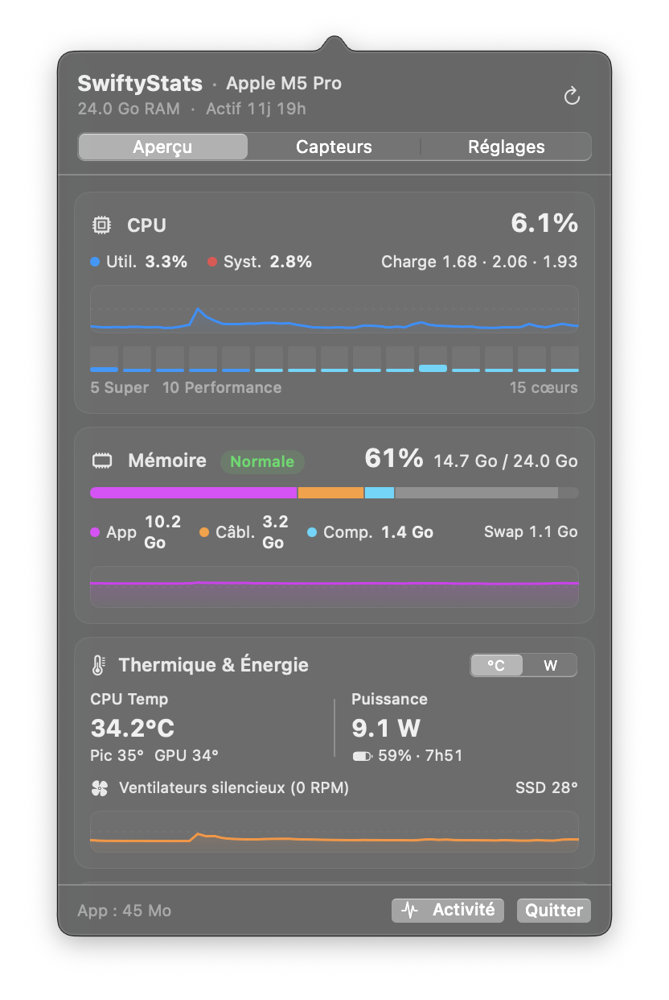

<div align="center">



# SwiftyStats

**Moniteur système macOS ultra-compact et 100 % Swift natif pour la barre des menus.**


Conçu pour prendre un minimum de place dans la barre des menus (un seul bloc unifié, sans gros espaces ni icônes qui s'intercalent) et une empreinte CPU / RAM minuscule en tâche de fond.

<br>



<sub><b>Barre des menus unifiée (~89 pt)</b> — CPU, RAM et Température CPU sur 2 lignes Retina</sub>

<br>



<sub><b>Popover complet au clic</b> — CPU par cœur, mémoire, pression système, thermique, puissance et processus</sub>

</div>

---

## Pourquoi SwiftyStats ?

- **Un seul bloc dans la barre des menus** : un unique `NSStatusItem` rendu en Retina 2× via CoreGraphics (2 lignes empilées, police à chiffres à chasse fixe). Résultat : **~50 % moins large** que plusieurs widgets séparés, et aucune autre app ne peut s'intercaler entre vos métriques.
- **Empreinte minimale au repos** : lorsque le popover est fermé, la vue SwiftUI est libérée et seuls les appels Mach + un petit ensemble de clés `AppleSMC` mises en cache sont interrogés (**~13 Mo** de `phys_footprint` au repos, **2,5 Mo** sur disque, zéro scan de processus en arrière-plan).
- **Zéro dépendance externe** : uniquement AppKit, SwiftUI, Mach, IOKit (`AppleSMC` / `IOHID` / `IOKit.ps`) et `ServiceManagement`.
- **Découverte dynamique des capteurs** : s'adapte automatiquement aux puces Apple Silicon (M1 à M5 Pro/Max) ainsi qu'aux Mac Intel.

---

## Fonctionnalités

### Barre des menus
- **Métriques configurables** : `CPU` (%), `RAM` (% ou Go), `TMP` (température CPU moyenne ou pic max, °C/°F) et `PWR` (consommation système totale en Watts via `PSTR`).
- **3 modes de couleurs** :
  - **Alerte** *(par défaut)* : monochrome adaptatif natif macOS (`template`) au repos, coloration orange/rouge uniquement lors d'un pic de charge ou de température.
  - **Mono** : toujours monochrome adaptatif.
  - **Couleur** : code couleur discret par métrique.
- **Clic droit** : menu natif rapide pour basculer les métriques affichées ou quitter.

### Popover au clic (3 onglets)
- **Aperçu** :
  - **CPU** : % global, détail Utilisateur / Système, load average (`1m · 5m · 15m`), sparkline temps réel et barres d'utilisation par cœur regroupées par cluster (`Super` / `Performance` / `Efficiency`).
  - **Mémoire** : % et Go utilisés alignés sur le Moniteur d'activité, badge de pression mémoire macOS (`Normale` / `Élevée` / `Critique`), barre segmentée (`App`, `Câblée`, `Compressée`, `Cache`), Swap et sparkline.
  - **Thermique & Énergie** : température CPU (moyenne & pic max), GPU, SSD, puissance totale (W), état batterie / temps restant, vitesse des ventilateurs et sparkline basculable `°C` / `W`.
  - **Top Processus** : top 5 processus par CPU ou RAM (collectés uniquement quand le popover est ouvert).
- **Capteurs** : vue détaillée des sondes thermiques (CPU, GPU, SoC/ANE, SSD/NAND, Batterie), rails d'alimentation SMC (`PSTR`, `PDTR`, `PPBR`, `PHPC`, `PHPM`, `PHPS`, `PTHS`), ventilateurs et batterie.
- **Réglages** : aperçu en direct de la barre des menus, sélection des métriques, formats (`%`/`Go`, `°C`/`°F`, `Moyenne`/`Pic max`), espacement (`Ultra-compact` / `Standard`), fréquence (`1s` à `5s`) et **Lancer au démarrage** via `SMAppService`.

---

## Installation

### Prérequis
- macOS 14 (Sonoma) ou plus récent
- Swift 6+ (Xcode ou Command Line Tools)

### Compiler et installer dans `/Applications`

```bash
git clone https://github.com/besty-boy/swifty-stats.git
cd swifty-stats
./scripts/build-app.sh --install --run
```

> **Astuce** : l'installation dans `/Applications/SwiftyStats.app` permet d'activer l'option **Lancer au démarrage de macOS** depuis l'onglet *Réglages*.

### Compiler sans installer

```bash
./scripts/build-app.sh
open dist/SwiftyStats.app
```

### Lancer les tests

```bash
swift test
# ou si seul CommandLineTools est actif par défaut :
DEVELOPER_DIR=/Applications/Xcode.app/Contents/Developer swift test
```

---

## Architecture

```text
Sources/
├── SwiftyStatsCore/          # Bibliothèque pure (testable indépendamment)
│   ├── CPUCollector.swift    # Mach host_processor_info, topologie sysctl, loadavg, uptime
│   ├── MemoryCollector.swift # Mach host_statistics64, swap, pression mémoire, footprint
│   ├── SMCReader.swift       # Client AppleSMC IOKit avec découverte & cache des clés
│   ├── IOHIDTempFallback.swift
│   ├── SensorCollector.swift # Agrégation thermique, rails W, ventilateurs, batterie IOKit.ps
│   ├── ProcessCollector.swift# Top CPU / RAM à la demande
│   ├── SettingsStore.swift   # Préférences UserDefaults + SMAppService
│   ├── SystemMonitor.swift   # Orchestrateur @MainActor avec polling adaptatif
│   ├── Models.swift          # Modèles Sendable + RingBuffer
│   └── Formatting.swift      # Formatage compact & seuils d'alerte
└── SwiftyStats/              # App macOS native (LSUIElement)
    ├── SwiftyStatsApp.swift
    ├── StatusBarController.swift # NSStatusItem unique + rendu CoreGraphics Retina 2×
    ├── PopoverRootView.swift
    ├── OverviewTabView.swift
    ├── SensorsTabView.swift
    ├── SettingsTabView.swift
    └── SparklineView.swift
```
